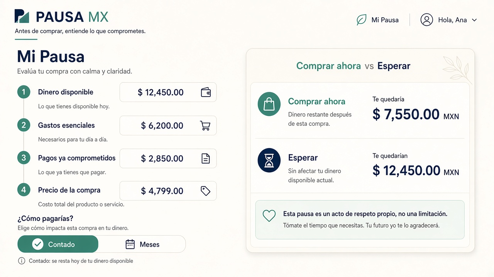
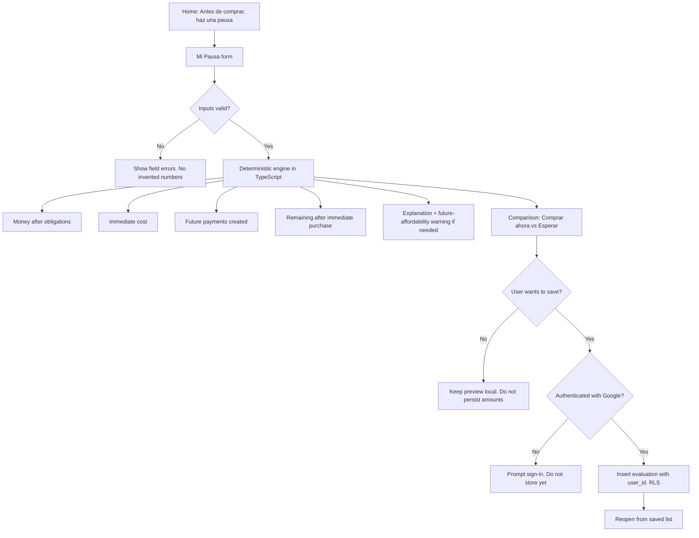
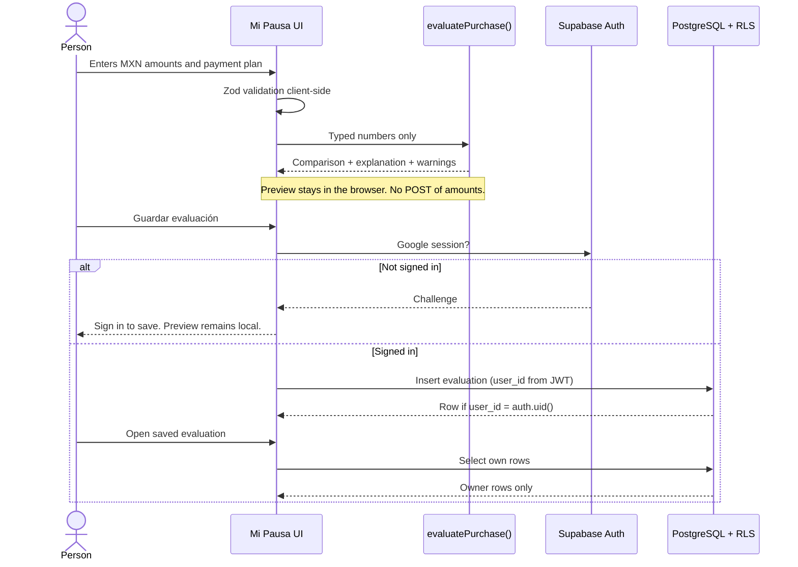

# PACKET — PAUSA MX Week 12

Founder: Miguel Bravo  
Course: AI 2041 — Week 12 — Extraction + the core build  
Selected candidate: PAUSA MX (explored in Week 10)  
Language of product UI: Mexican Spanish  
Documentation language: English, except quoted product copy  

**Provisional methodology.** METHOD, VERDICT, MANIFESTO, and the Week 12 team BLUEPRINT were not in the workspace. See `docs/SOURCE_REVIEW.md`.

Step 3 of my Method becomes the function that converts a proposed purchase, existing obligations and available money into a transparent comparison of the user’s financial position before and after buying.

---

## 1. Problem in the founder’s words

Many people in Mexico judge a purchase by the number on the product screen. That number is not the same as what the purchase does to money that is already claimed by rent, food, transport, and payments already promised. Installment tables make the monthly quote look small and leave the total actually committed, and the cash left today, off-stage. PAUSA MX exists so someone can pause and see those constraints before they buy. It does not approve credit, connect a bank, or tell them they are good or bad with money.

---

## 2. Exact user

A young adult in Mexico who is considering a consumer purchase, can type a few amounts in MXN, and wants to understand the effect on available money. Primary design hypotheses: Valeria (23, CDMX, salary, phone, full payment) and Daniel (27, variable income, computer, installments). Both are synthetic. See `docs/PERSONAS.md`.

---

## 3. Definition of success before the module closes

The module is successful for Week 12 if **all** of the following are true:

1. Charter, personas, and packet exist in git **before** this repository’s application rebuild commits.
2. One working feature, Mi Pausa, computes a consistent comparison from typed inputs.
3. Unit tests cover the required mechanical cases.
4. Private save requires Google authentication via Supabase; RLS restricts rows to the owner.
5. Public Vercel deployment exists. A real purchased domain is connected **or** the founder has exact purchase instructions (this agent cannot buy a domain).
6. Documentation states what was tested and what was not invented.

Success is **not** a claimed 10x impact, a paying customer, or a completed external persona-test chat until those actually happen.

---

## 4. Visual mockup

Generated with Cursor image generation on 2026-11-01 and saved as [`docs/mockup.png`](mockup.png). It is a product UI illustration of Mi Pausa (form + Comprar ahora / Esperar). It is not a screenshot of the production app.

---

## 5. Mermaid flowchart

---

## 6. Mermaid sequence diagram

---

## 7. Global benchmark and differentiation

**Comparable product (verified pages):** BBVA México publishes consumer financial-education calculators, including “Interactivos dinero inteligente”:

- https://www.bbva.mx/educacion-financiera/interactivos-dinero-inteligente.html

That page (fetched 2026-11-01) presents simulators such as a 70/20/10 administration method and a calculator “para practicar cómo organizar mejor tu dinero, controlar tus gastos y planear tu ahorro.”

A related BBVA budget calculator (BBVA corporate site, Spanish, fetched 2026-11-01) is:

- https://www.bbva.com/es/salud-financiera/calculadora-presupuestos/

**Verified from that page:** it asks for monthly net income and categories of expenses (obligatory fixed, reducible fixed, and easier-to-change spending). It states: “Tus datos están seguros. Este servicio no almacenará la información que introduzcas.”

**Assumptions (not verified on this pass):** that the BBVA México interactive calculators persist nothing server-side; that they do not compare a specific contemplated purchase against existing commitments; that they are education tools attached to a bank brand.

**Differentiation (product intent, not a competitive study):** PAUSA MX is purchase-decision shaped (one contemplated buy, obligations, payment plan as typed, Comprar ahora vs Esperar). It is not a bank product, does not recommend BBVA or any lender, and does not invent a 50/30/20 or 70/20/10 split.

Week 10 PAUSA MX is an ancestor prototype (suggestion engine, localStorage). This rebuild removes the buy/wait command and adds authenticated persistence.

---

## 8. Three-sentence long view

If people repeatedly use a pause that makes constraints visible, they may buy fewer things they cannot carry — or buy the same things with fewer surprises. The venture can later charge for saved history, shared household context, or a documented export, only after someone other than the founder says those are worth paying for. Until then the 10:1 hypothesis is a claim to test, not a result.

---

## 9. Scope cuts

Out of Week 12:

- Merchant catalog, checkout, BNPL partnerships
- Bank aggregation
- Multi-obligation calendar (Week 10 `/pagos`)
- Verbal recommendation engine (Week 10 outcomes)
- Chatbot
- Custom domain purchase performed by the agent
- Real user interviews
- Analytics suite for the north star

---

## 10. Architecture and stack

| Layer | Choice | Why |
| --- | --- | --- |
| App | Next.js App Router | Required; server actions for save |
| UI | React + Tailwind CSS | Required; mobile-first |
| Language | TypeScript strict | Testable engine |
| Validation | Zod | Client and server |
| Engine | Pure functions in `src/engine` | Independent of UI |
| Auth | Supabase Auth, Google OAuth | Required for private save |
| Data | Supabase PostgreSQL + RLS | Owner-only evaluations |
| Tests | Vitest + Playwright | Engine + smoke |
| Host | Vercel | Required |
| Repo | GitHub | Required |
| Secrets | `.env.local` uncommitted; `.env.example` committed | No service-role in browser |

---

## 11. Mechanical test plan

See also `docs/TEST_PLAN.md` (created with the test suite). Required cases:

1. Valid full-payment purchase  
2. Purchase exceeding available money  
3. Zero available money  
4. Installment plan with valid values  
5. Invalid installment data  
6. Negative amounts  
7. Extremely large values  
8. Decimal rounding  
9. Empty required fields  
10. Unauthenticated save attempt  
11. Authenticated save and reopen  
12. RLS isolation between two test users  

---

## 12. Persona test plan

A synthetic persona test of Valeria or Daniel must run in a **fresh LLM chat** with real screenshots of the working app. This packet does not contain that test. Script and evidence log: `docs/PERSONA_TEST.md`.

---

## 13. Security plan

- Google OAuth required to persist evaluations  
- RLS: `user_id = auth.uid()` for select/insert/update/delete  
- Anon key in browser; **service-role key never in client**  
- Zod on client and server; numeric range 0–10,000,000.00 MXN; installment count 2–60  
- Preview mode: compute in-browser only  
- Privacy page in Mexican Spanish explaining data use  
- Secret scan before each push  

---

## 14. Genuine commit and deployment plan

1. Charter, personas, packet (this commit family)  
2. Project architecture and interface  
3. Deterministic engine and unit tests  
4. Supabase auth, persistence, RLS  
5. QA, docs, deployment readiness  

Push to GitHub when authenticated. Deploy to Vercel at least twice. Domain purchase is a founder step.

---

## 15. Evidence requirements

Allowed as evidence only if real: git log, test runner output, Vercel deployment IDs, public HTTP checks, SQL migration files, screenshots of this app, Cursor-generated mockup file.

Not allowed to fabricate: interviews, team votes, domain purchase, DEMO video, BUILDCHAT export, persona-test results, 10x impact, invented bugs.

---

## Engine sketch (normative)

Let amounts be decimal MXN rounded to 2 places using banker’s rounding only after cent conversion (integer cents).

- `moneyAfterObligations = availableMoney − essentialExpenses − committedPayments`
- `immediateCost = full payment ? purchasePrice : downPayment`
- `futurePaymentsTotal = full payment ? 0 : installmentCount × installmentAmount`
- `remainingAfterImmediate = moneyAfterObligations − immediateCost`
- `waitRemaining = moneyAfterObligations`
- `waitFutureFromThisPurchase = 0`
- If installments: `enteredPurchaseTotal = downPayment + futurePaymentsTotal`; `differenceVsCashPrice = enteredPurchaseTotal − purchasePrice`
- Future affordability warning when payment method is installments **or** when any future amount is created, because the form does not collect future income.

The Comparison presents these figures. It does not select a winner.
