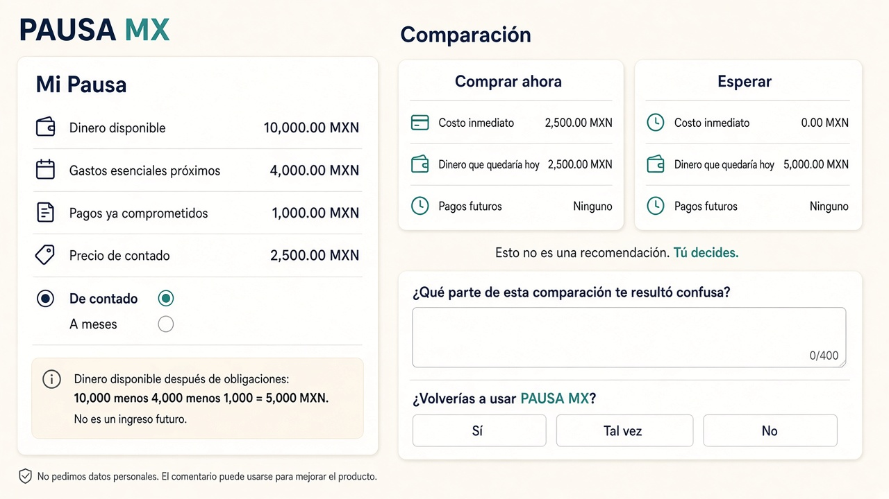
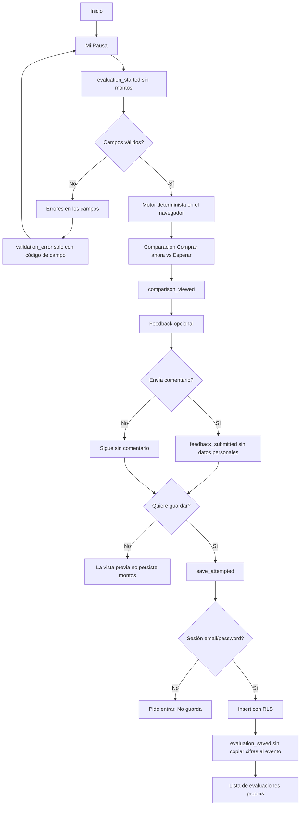
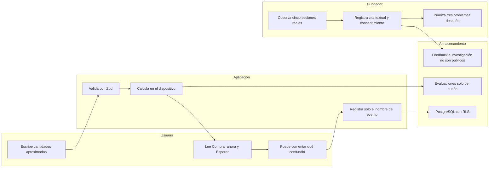

# PACKET — PAUSA MX Week 13, Real Humans

Founder: Miguel Bravo  
Course: AI 2041 — Week 13 — Real Humans  
Role: MONEY  
Product: PAUSA MX  
Language of the product UI: Mexican Spanish  
Language of this packet: Spanish  

This packet was written **before** Week 13 application code. It does not claim that the features below already exist in the running app.

Canonical mockup (generated image, not a production screenshot): [`docs/week13-mockup.png`](week13-mockup.png)

Production already online from Week 12, checked before this packet: https://pausa-mx-week12.vercel.app  
GitHub: https://github.com/miguelbbuilds-gif/pausa-mx-week12

---

## Estado inicial (Fase 0)

Recorded 2026-11-08 local (HTTP `Date: Mon, 09 Nov 2026 01:41:47 GMT`).

| Item | Evidence |
| --- | --- |
| Starting commit | `3f2b42b3cfe6f76064208db837c2b2484b2b604d` — “Replace Google OAuth with email/password Auth while keeping RLS.” |
| Branch created | `week13-real-humans`, from `main`, without discarding uncommitted Week 12 submission files |
| Week 12 unit tests before any Week 13 code | `npm test` — 15 passed (engine, auth schema, env guard) |
| Production HTTP | `https://pausa-mx-week12.vercel.app` and `/product` both `HTTP/1.1 200 OK` |
| Preserved behavior | Mi Pausa, deterministic engine, email/password auth, saved evaluations |
| Local public env names present | `NEXT_PUBLIC_SUPABASE_URL`, `NEXT_PUBLIC_SUPABASE_ANON_KEY`, `NEXT_PUBLIC_SITE_URL`. No service-role name. No Google client secret name. |
| Week 13 team Blueprint | **PENDING.** See [`docs/WEEK13_BLUEPRINT.md`](WEEK13_BLUEPRINT.md). Conditions and shadow clause were not invented. |

---

## 1. Problema

Los consumidores mexicanos necesitan comprender el impacto financiero de una compra sobre el dinero disponible y las obligaciones que ya existen. PAUSA MX ya muestra esa comparación con aritmética determinista. Lo que todavía no sabemos es **qué partes de esa comparación les resultan confusas**.

Week 13 no cambia el problema de producto. Agrega una forma de observar la confusión: eventos sin montos, un comentario opcional, y un registro de investigación que solo el fundador puede llenar con sesiones reales.

---

## 2. Usuario exacto

Adultos mexicanos que evalúan compras personales y pueden introducir cantidades aproximadas en MXN.

No se exige un rango de edad más estrecho que “adulto”. Las personas sintéticas Valeria (23) y Daniel (27) en [`docs/PERSONAS.md`](PERSONAS.md) siguen siendo hipótesis de diseño, no entrevistados. El usuario de Week 13 es cualquiera de esas personas reales que pueda completar la tarea con cifras aproximadas, sin conectar un banco.

---

## 3. Definición de éxito

Week 13 queda cumplida solo si **todo** lo siguiente es verdad y está evidenciado:

1. Cinco sesiones reales de uso observado (presencial o pantalla compartida).
2. Al menos tres de esas cinco personas eran desconocidas para el fundador antes de la sesión.
3. Tres problemas priorizados a partir de esas observaciones, no elegidos de antemano.
4. Corrección del problema principal (el #1 de esa priorización).
5. Un despliegue nuevo de esa corrección.
6. Evidencia de al menos un participante que diga que volvería a usar PAUSA MX.

Hasta que esas sesiones existan, el éxito de Week 13 está **incompleto**. Implementar feedback no sustituye a las cinco personas.

---

## 4. Mockup visual

Generado con la herramienta de imágenes de Cursor el 2026-11-08 y guardado como [`docs/week13-mockup.png`](week13-mockup.png).

Es una ilustración de interfaz. **No es una captura de producción** y no es evidencia de una sesión humana.

Las cifras del dibujo son el ejemplo ficticio ya usado en la home de Week 12: 10,000 disponibles, 4,000 esenciales, 1,000 comprometidos, compra de contado de 2,500. Dinero después de obligaciones = 5,000. Comprar ahora deja 2,500 hoy. Esperar deja 5,000 hoy. El motor de la aplicación sigue siendo la fuente de verdad; si el dibujo y el código discrepan, manda el código.

---

## 5. Flujo completo

---

## 6. Swimlane

---

## 7. Benchmark

Comparación hecha el 2026-11-08. Hecho significa que una página pública lo dice. Hipótesis significa que este paquete no lo comprobó.

### YNAB (You Need A Budget)

Fuentes leídas: [ynab.com/pricing](https://www.ynab.com/pricing) y [ynab.com/features](https://www.ynab.com/features), 2026-11-08.

**Hechos publicados por YNAB:**

- Plan anual 109 USD (presentado como 9.08 USD al mes) y plan mensual 14.99 USD, más impuestos donde aplique.
- Prueba de 34 días sin tarjeta si el alta es directo en YNAB.
- Propone conectar cuentas, importar transacciones, metas y un plan de deuda.
- La importación directa, según su FAQ de precios, cubre bancos seleccionados de EE. UU., Canadá, Reino Unido y la UE. Fuera de esas regiones ofrecen importación por archivo.
- El precio está en dólares estadounidenses; la FAQ dice que el tipo de cambio no está reflejado en el precio.
- Afirman no vender los datos y cobrar la suscripción. Esa frase es una afirmación de YNAB, no una auditoría de PAUSA MX.

**Hipótesis:** YNAB no está diseñado para una sola compra mexicana en MXN contra obligaciones ya escritas, sin conectar un banco. No se abrió una cuenta de YNAB para comprobarlo.

### MoneyHelper (Reino Unido)

Fuentes: [Budget planner](https://www.moneyhelper.org.uk/en/everyday-money/budgeting/budget-planner) y el registro [GOV.UK algorithmic transparency](https://www.gov.uk/algorithmic-transparency-records/money-and-pensions-service-budget-planner), 2026-11-08.

**Hechos:**

- Herramienta gratuita de MoneyHelper / Money and Pensions Service.
- Suma ingresos y gastos por categorías y muestra lo que queda.
- El registro de GOV.UK describe consejos personalizados, guardado y descarga a hoja de cálculo, y dice que toma unos 5–10 minutos.
- Está pensada para personas en el Reino Unido, no como producto mexicano.

**Hipótesis:** no compara “comprar este artículo ahora” contra “esperar” con un plan de pagos escrito por el usuario. No se completó el planner con datos reales.

### Solución mexicana: CONDUSEF, Planificador de Presupuesto Personal y Familiar

Fuente: la página oficial respondió el 2026-11-08 con título `CONDUSEF | Planificador de Presupuesto Personal y Familiar` en https://phpapps.condusef.gob.mx/planifica/index.php

El índice de búsqueda de esa misma URL muestra esta advertencia de la propia herramienta: los resultados dependen de los datos que ingrese el usuario y la Comisión no se hace responsable del impacto en su economía. Una segunda lectura del cuerpo completo se cortó por tiempo, así que **esa advertencia se cita como extracto del índice, no como HTML re-leído línea por línea**.

Página de CONDUSEF que describe el planificador (resultado de búsqueda, 2026-11-08): https://www.condusef.gob.mx/?idc=1328&idcat=3&p=contenido — habla de presupuesto anual a partir de datos mensuales y de un simulador de meta de ahorro.

**Hechos:** existe un planificador público mexicano de ingresos, gastos y capacidad de ahorro, distinto de un banco comercial.

**Hipótesis:** no aísla una compra contemplada con enganche y mensualidades escritas, ni muestra “Comprar ahora / Esperar” sin recomendar. No se terminó una simulación dentro del planificador en esta sesión.

### BBVA México (contexto, no es el tercer comparable principal)

[Interactivos dinero inteligente](https://www.bbva.mx/educacion-financiera/interactivos-dinero-inteligente.html), leído 2026-11-08, ofrece la regla 70/20/10 y una calculadora para practicar cómo organizar gastos y planear ahorro. Es educación de un banco. PAUSA MX no adopta esa regla ni recomienda a BBVA.

### Diferencia de PAUSA MX

PAUSA MX sigue siendo una pausa de **una compra**: dinero disponible, obligaciones ya escritas, precio y, si aplica, el plan de pagos que la persona tecleó. No conecta un banco, no cobra suscripción, no inventa una tasa y no dice “compra” o “espera”. Week 13 añade la pregunta de qué parte confundió. Eso es medición, no un consejo nuevo.

---

## 8. Long view

Dentro de tres años, PAUSA MX puede ser el lugar breve al que un adulto en México entra antes de una compra que movería el dinero del periodo, y sale con la cuenta a la vista. Si las sesiones reales muestran qué frases confunden, el producto puede aclararlas sin convertirse en un asesor que decide por la persona. Cualquier cobro por historial o por un hogar compartido sigue siendo una hipótesis hasta que alguien distinto del fundador diga que volvería y por qué.

---

## 9. Scope cut

Queda fuera de Week 13:

- Cambiar el motor para que recomiende comprar o esperar.
- Conexión bancaria, Buró de crédito, CLABE, o puntuación de la persona.
- Catálogo de tiendas, checkout, o meses sin intereses negociados con comercios.
- Chatbot como función central.
- Analítica con montos, nombres, correos, contraseñas o tokens.
- Inventar citas, sesiones o un “problema humano #1” antes de las cinco sesiones.
- Comprar el dominio con la tarjeta del agente.
- Declarar que correo y contraseña equivalen a Sign in with Google.
- Borrar evaluaciones ya guardadas o reescribir su migración.

---

## 10. Arquitectura y stack

| Capa | Elección | Por qué |
| --- | --- | --- |
| App | Next.js App Router, ya en el repo | Server Actions para guardar y para operaciones del fundador |
| UI | React + Tailwind | El diseño ejecutivo de Week 12 se mantiene |
| Lenguaje | TypeScript estricto | El motor sigue siendo testeable |
| Validación | Zod | Formularios de compra, feedback e investigación |
| Motor | `src/engine` sin cambio de regla | La comparación no se vuelve una recomendación |
| Auth | Supabase Auth email/password | Ya existe. Google OAuth queda pendiente si no hay credenciales |
| Datos | Supabase PostgreSQL + RLS | Evaluaciones, eventos, feedback, investigación |
| Admin | Comprobación en servidor + RLS `is_founder()` | Ocultar un enlace no basta |
| Pruebas | Vitest + Playwright | Mecánicas, no personas reales |
| Host | Vercel | El mismo proyecto |
| Secretos | `.env.local` y variables de Vercel, nunca el service role en el cliente | Sin secretos en el repositorio |

---

## 11. Plan de pruebas

### Mecánicas

- TypeScript, ESLint, Vitest, Playwright.
- Casos financieros ya cubiertos por el motor (no se relajan).
- Feedback: vacío, texto demasiado largo, valor de retorno inválido, honeypot, límite de envíos.
- Eventos: solo nombres permitidos; un payload con monto o correo se rechaza.
- Auth email/password sigue guardando y reabriendo.
- RLS: un usuario no lee eventos, feedback ni sesiones de investigación de otro.
- `/investigacion` responde no autorizado si la sesión no es del fundador.
- Viewport móvil del formulario y del feedback.
- HTTP de producción después de cada despliegue declarado.

### Persona sintética

Guion para un chat nuevo, con capturas reales de la app en orden. La persona de partida es Valeria, marcada como sintética en `docs/PERSONAS.md`. Si ese chat externo no se ejecuta aquí, el resultado queda **PENDIENTE**. El mockup no cuenta como captura.

### Cinco usuarios reales

Protocolo, bitácora, priorización y antes/después en documentos aparte. Cero filas se llenan con personas imaginarias. El problema #1 se elige solo después de cinco sesiones con evidencia.

---

## 12. Seguridad y privacidad

1. Ningún secreto en el repositorio ni en el bundle del cliente. La anon key pública no es la service role.
2. La sesión de Supabase Auth sigue siendo obligatoria para guardar evaluaciones.
3. RLS activo en evaluaciones y en toda tabla nueva con datos privados. Lectura pública de investigación: no.
4. Límites de caracteres, tipos y frecuencia en feedback y eventos.
5. Los ejemplos de la interfaz siguen marcados como ficticios. Las sesiones DEMO, si se usan en pruebas, llevan la etiqueta DEMO y no cuentan como humanos.
6. El comentario advierte que puede usarse para mejorar el producto y pide no incluir datos personales.
7. Google OAuth: **PENDIENTE** hasta que existan cliente de Google y proveedor activado en Supabase. Correo y contraseña no se presentan como sustituto.

---

## 13. Criterios de aceptación verificables

| Criterio | Cómo se verifica | Estado al escribir este packet |
| --- | --- | --- |
| Packet en git antes del código de Week 13 | El commit de este archivo no toca `src/` | Por cumplir en el commit inmediato |
| Eventos sin datos sensibles | Prueba que rechaza montos y correos | Aún no implementado |
| Feedback opcional con confirmación | Prueba de UI o de acción | Aún no implementado |
| Panel del fundador niega a otros usuarios | Prueba de servidor / RLS | Aún no implementado |
| Motor intacto | Vitest del engine sigue en verde | 15 pruebas verdes antes del código nuevo |
| Cinco humanos | Bitácora con evidencia | Pendiente |
| Problema #1 corregido | Antes/después con capturas reales | Pendiente; no se elige hoy |
| Dos despliegues Vercel | IDs, fecha, SHA, URL | Pendiente |
| Dominio comprado | DNS + HTTPS del dominio propio | Pendiente |
| Sign in with Google | Botón que completa OAuth | Pendiente |

---

## 14. Requisitos externos pendientes

| Requisito | Estado | Quién actúa |
| --- | --- | --- |
| Blueprint Week 13: condiciones y shadow clause | PENDIENTE — no está el documento | Miguel, si el equipo lo entrega |
| Sign in with Google | PENDIENTE — no hay client id/secret en el entorno | Miguel, en Google Cloud y Supabase |
| Alta del fundador en `app_admins` | Se documentará con la migración; hoy no hay fila | Miguel, un `insert` en SQL |
| Dominio comprado | PENDIENTE — este agente no paga | Miguel |
| Cinco sesiones, tres desconocidos | PENDIENTE — no hay evidencia | Miguel |
| Consentimiento de esas personas | PENDIENTE | Miguel y cada participante |
| Export de BUILDCHAT desde Cursor | PENDIENTE — no se redacta un chat ficticio | Miguel |
| Video DEMO mp4 | PENDIENTE — no hay grabación de pantalla | Miguel |
| Aplicar la migración SQL nueva en Supabase | Pendiente hasta que el SQL exista y Miguel lo ejecute, o hasta que el CLI autenticado pueda hacerlo | Miguel si hace falta el dashboard |

RDAP el 2026-11-09 01:44 UTC: `https://rdap.org/domain/pausamx.site`, `pausamx.online` y `pausamx.com` respondieron **302**. `pausamx.mx` respondió **404** `application/rdap+json`. Ninguno de esos códigos demuestra que el nombre esté libre, premium o ya comprado. No hay dominio propio de PAUSA MX en este repositorio. La lista de precios de Porkbun del 2026-11-01 (1.96 USD el primer año de `.site` y `.online`) **no se volvió a leer** en esta sesión.

---

## Lo que este packet no afirma

No afirma que un humano ya haya vuelto, que Google OAuth funcione, que el dominio exista, ni que una mejora de copy esté validada por usuarios. Esas frases solo podrán escribirse después, junto a la evidencia.
