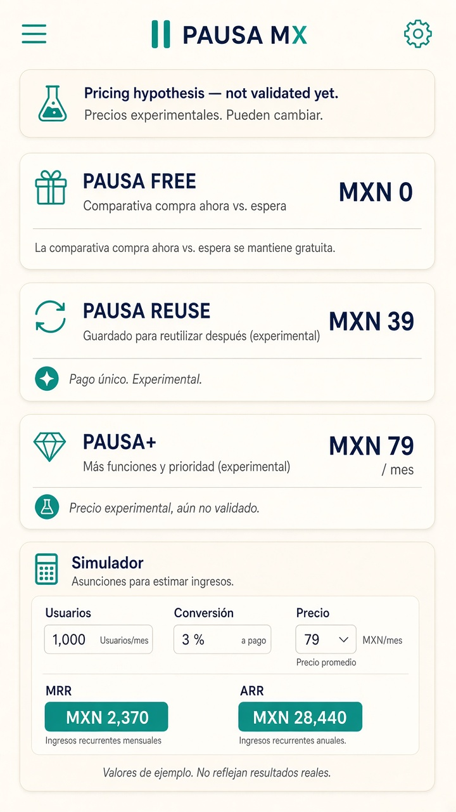
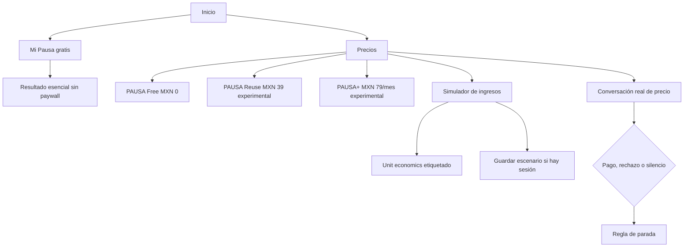
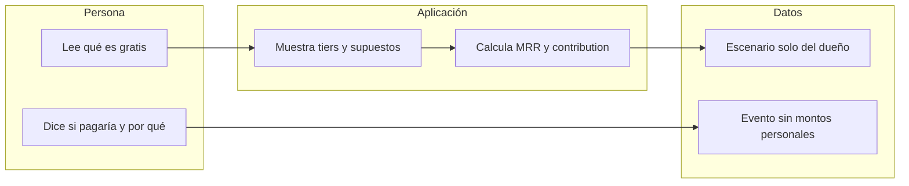

# PACKET — PAUSA MX Week 14, Pricing

Founder: Miguel Bravo  
Course: AI 2041 — Week 14 — Pricing  
Role: ADVERSARY  
Product: PAUSA MX  
Language of the product UI: Mexican Spanish  

This packet was written **before** Week 14 application code. It does not claim that `/pricing`, the simulator, or saved scenarios already exist.

Adversary declaration, recorded as the founder’s instruction, not as observed demand:

“Show MXN 79/month PAUSA+ beside the free core; measure payment, frequency and rejection reasons.”

Canonical mockup (generated image, not a production screenshot): [`docs/week14-pricing-mockup.png`](week14-pricing-mockup.png)

Production already online: https://pausa-mx-week12.vercel.app  
GitHub: https://github.com/miguelbbuilds-gif/pausa-mx-week12

---

## Estado inicial

Recorded 2026-11-15 local, before Week 14 code.

| Item | Evidence |
| --- | --- |
| Starting commit | `83ca0df` on `main` and `week13-real-humans` |
| Branch created | `week14-pricing`, from `main`, without discarding uncommitted Week 12 submission files |
| Week 12 and Week 13 | Left in place. No `supabase db reset`. No table drops. |
| Purchased domain | Still absent. Vercel listed 0 domains on 2026-11-08. `*.vercel.app` is only the backup URL. |
| Google sign-in | Button and `/auth/callback` exist. Completing Google still needs the provider credentials. Email/password is not a substitute. |
| `app_admins` | Was 0 rows on 2026-11-08 because `miguelb.builds@gmail.com` was not in `auth.users`. Not rechecked as a new admin in this packet. |
| Human evidence | Week 13 sessions: 0. No pricing conversation yet. |

---

## 1. Problema, en mis palabras

La comparación de Mi Pausa ya se puede usar sin pagar. Week 14 no cambia esa cuenta. Pregunta otra cosa: si alguien vuelve a usar PAUSA MX, ¿hay un precio honesto por guardar y reabrir ese trabajo, y otro precio experimental por un historial recurrente? Un “sí, pagaría” amable no es una suscripción. Un precio publicado en Estados Unidos no es disposición a pagar en México.

## 2. Usuario exacto

Adulto en México que ya puede escribir cantidades aproximadas y leer Comprar ahora frente a Esperar. La persona de diseño sigue siendo hipótesis. No es un cliente entrevistado.

## 3. Quién pagaría

Dos hipótesis de pagador, no dos contratos:

1. La misma persona, si el valor repetido de guardar escenarios le importa más que seguir calculando gratis.
2. Un empleador o patrocinador de bienestar financiero, que pagaría por empleados. El empleado seguiría siendo quien usa la comparación. No hay cliente B2B ni piloto firmado.

El core esencial no tiene pagador. Es gratis.

## 4. Definición de éxito

“Before the module closes, /pricing works, the pricing simulator works, unit economics are visible, saved scenarios work, the 10:1 memo is live, the Blueprint conditions are implemented, and one real pricing conversation is documented.”

La última frase no se cumple con este packet. Hasta que exista una conversación real, el éxito de Week 14 está incompleto.

## 5. Mockup

Generado el 2026-11-15 y guardado como `docs/week14-pricing-mockup.png` (655045 bytes). Es una ilustración de la pantalla de precios. No es una captura de producción y no es evidencia de pago.

## 6. Flujo

## 7. Swimlane

## 8. Benchmark global y localización a México

Revisado el 2026-11-15. Ningún precio de abajo se trata como disposición a pagar en México. No se abrió una cuenta de pago.

| Producto | Fuente | Qué se leyó | Qué sí traduce | Qué no |
| --- | --- | --- | --- | --- |
| YNAB | https://www.ynab.com/pricing | 109 USD al año o 14.99 USD al mes, más impuestos. Prueba de 34 días sin tarjeta. Precio en USD; el tipo de cambio no está incluido. | Un presupuesto completo y recurrente puede cobrarse en otro país. | No es una pausa de una compra en MXN y no prueba que alguien en México pague 79. |
| Rocket Money | https://www.rocketmoney.com/learn/personal-finance/how-much-does-rocket-money-cost y el centro de ayuda de Premium+ | Versión gratis. Premium: “pay what you think is fair”, el propio texto dice un rango típico de 7 a 14 USD al mes, sujeto a cambio. Premium+: 15 USD al mes más impuestos. | Existe un gratis al lado de un pago. El rango elegido por el usuario no es un precio validado para PAUSA MX. | Negociación de facturas y conexión de cuentas no son el producto. No es evidencia mexicana. |
| CONDUSEF Planificador | https://phpapps.condusef.gob.mx/planifica/index.php | El 2026-11-08 el título de la página era el Planificador de Presupuesto Personal y Familiar. El 2026-11-15 la misma URL respondió HTTP 504. Esta pasada no vuelve a afirmar que la herramienta cargó. | La alternativa pública mexicana, cuando está en línea, es gratis. | Un timeout no demuestra que el planificador desapareció ni que la gente lo prefiera. |

Conclusión obligatoria: **PAUSA MX is competing with free.**

## 9. Vista a tres años

Si la comparación gratis sigue resolviendo el trabajo, PAUSA MX puede quedarse como herramienta breve y sin suscripción. Si personas distintas del fundador guardan escenarios y vuelven, un pago único de reutilización o un patrocinio de empleador pueden tener sentido. Cobrar 79 al mes dentro de tres años solo se sostiene si hay uso recurrente medido, contribution no negativa y un 10:1 que no dependa de un ahorro inventado. Eso hoy es una posibilidad, no un plan de ingresos.

## 10. Recorte de alcance

Fuera de esta semana: checkout real, cobro con tarjeta, descuentos, “más popular”, cuentas regresivas, miedo, culpa, paywall del resultado, ROI prometido, clientes B2B inventados, y tratar MXN 79 como precio validado.

## 11. Arquitectura y stack

| Capa | Elección |
| --- | --- |
| App | Next.js App Router, React, TypeScript, Tailwind |
| Validación | Zod y funciones puras del simulador |
| Auth | La sesión existente. Google sigue pendiente de proveedor. |
| Datos nuevos | `pricing_scenarios` con RLS `user_id = auth.uid()` |
| Eventos | Lista cerrada, sin montos personales, correos ni tokens |
| Host | El mismo proyecto de Vercel |

## 12. Plan de pruebas

TypeScript, ESLint, Vitest del simulador, Playwright de `/pricing`, build de producción, y una prueba de que el usuario B no lee el escenario del usuario A. Cero, negativos, decimales, valores enormes y 100% de conversión entran en la prueba mecánica. Una conversación humana no se simula.

## 13. Supuestos de precio

| Etiqueta | Cifra | Estado |
| --- | --- | --- |
| PAUSA Free | MXN 0 | El core ya existe y no se bloquea. El cero es una decisión de producto, no una medición de demanda. |
| PAUSA Reuse | MXN 39 | ASSUMED. Prueba de pago único por guardar y reabrir. No es suscripción validada. |
| PAUSA+ | MXN 79 al mes | ASSUMED. Precio experimental. No validado. |
| B2B | Sin cifra de lista | UNKNOWN. En el simulador se marca ASSUMPTION o PILOT HYPOTHESIS. |
| CAC, soporte, infraestructura, churn | Los captura quien usa el modo avanzado | ASSUMED o UNKNOWN. Ninguno es MEASURED al escribir esto. |

## 14. Supuestos de unit economics

`payingUsers = users × conversionRate`  
`MRR = payingUsers × monthlyPrice`  
`ARR = MRR × 12`  

Esos productos son aritmética del simulador, no ventas. Contribution es ingreso menos costos variables capturados. Si contribution es negativa, la pantalla no puede decir rentable. CAC payback es aproximado y solo aparece cuando el precio mensual es mayor que cero.

## 15. Condiciones del Blueprint

1. Transparent exchange: pagador, precio, duración, incluye, excluye, alternativa gratis y supuestos no verificados, siempre visibles. Sin ROI inventado.
2. Observed demand: separar interés, disposición declarada, compromiso, pago, repetición y renovación. Sin demanda recurrente afirmada.
3. Fully costed delivery: adquisición, onboarding, soporte, infraestructura, revisión, correcciones y excepciones entran al modo avanzado como supuestos, no como hechos.
4. Outcome verification: comprender, cambiar una decisión, repetir y reutilizar. Todavía no medido en personas.
5. Shadow clause: no monetizar vulnerabilidad. El resultado esencial sigue gratis. Sin paywall, sin miedo, sin countdown, sin culpa.
6. Precommitted stopping: si nadie paga, nadie vuelve, la frecuencia es baja, los costos superan la contribution o el 10:1 no se sostiene, se cambia el precio, el pagador, se prueba pago único, se explora patrocinio, se reduce el alcance o se abandona la suscripción. No se rescata con un descuento sin evidencia.

## 16. Seguridad

Sin secretos en el repositorio. Sin service role en el navegador. RLS en escenarios. Validación de servidor. Los ejemplos de precios son hipótesis marcadas. La conversación real, cuando exista, usa rol y no nombre.

## 17. Lo que este packet no afirma

No afirma pagos, clientes, entrevistas, un dominio comprado, ni que MXN 79 o MXN 39 hayan sido aceptados. Esas frases solo podrán escribirse junto a la evidencia.
